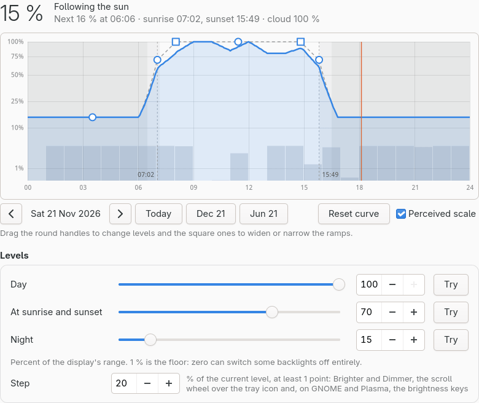
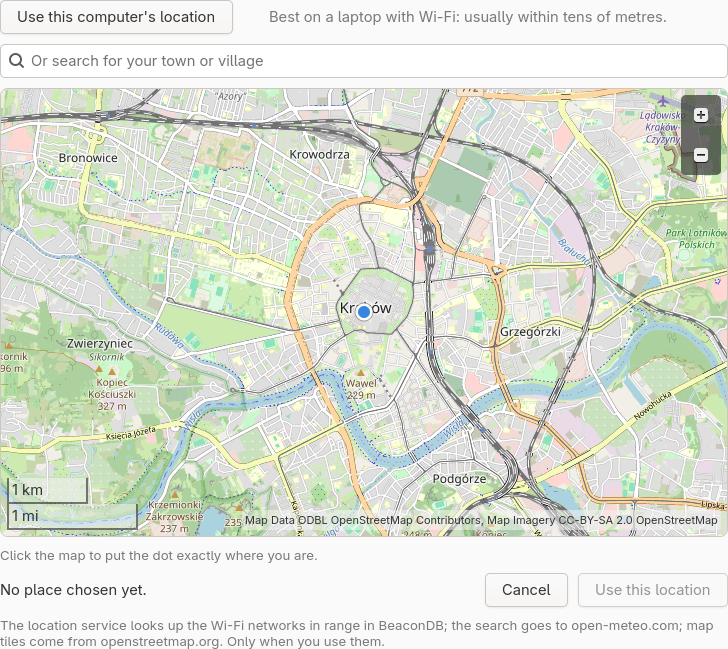
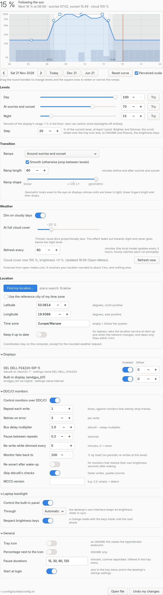

# Luxtide

[English](README.md) · **Polski**

Jasność ekranu, która podąża za słońcem, dla Linuksa. Luxtide przygasza
ekrany o zmierzchu i rozjaśnia je o świcie: monitory zewnętrzne przez DDC/CI,
ekrany laptopów przez ich podświetlenie, a jeśli masz jedno i drugie, to oba
naraz. W pochmurne dni może dodatkowo trochę przyciemnić, a gdy sam ustawisz
jasność, nie wchodzi ci w drogę.

<picture>
  <source media="(prefers-color-scheme: dark)" srcset="docs/screenshots/overview-dark.png">
  
</picture>

## W skrócie

| | |
|---|---|
| **Według słońca** | Przejścia wokół wschodu i zachodu albo jasność zależna od wysokości słońca. Ten drugi tryb sam dopasowuje się do pory roku i działa nawet za kołem podbiegunowym. Położenie słońca liczone jest lokalnie. |
| **Równo dla oka** | Przejścia mają kształt dobrany pod wzrok, nie pod sprzęt: domyślnie krzywa geometryczna, więc zmierzch nie trzyma pełnej jasności przez godzinę, by potem nagle zgasnąć. |
| **Pogoda** | Opcjonalnie: do 20 % mniej światła przy pełnym zachmurzeniu (do ustawienia), z prognozy [Open-Meteo](https://open-meteo.com). Ku nocy efekt wygasa. |
| **Monitory i laptopy** | Monitory zewnętrzne przez DDC/CI (`ddcutil`); ekrany laptopów przez GNOME, KDE Plasma albo logind, więc suwak i klawisze pulpitu dalej działają. Bez roota. |
| **Decydujesz ty** | Ręcznie ustawiony poziom obowiązuje do następnej fazy dnia. Pauza na dowolny czas albo do wybranej godziny. W GNOME i Plasmie klawisze jasności zmieniają ją własnym, drobniejszym krokiem Luxtide. |
| **Trzy sposoby obsługi** | Ikona w zasobniku, okno ustawień w GTK 4 z krzywą do przeciągania i polecenia `luxtide` oraz `dim`. Wszystko przez jedno API D-Bus. |
| **Lokalizacja jednym kliknięciem** | Usługa lokalizacji pulpitu, wyszukiwarka miejscowości albo mapa. Bez nich: miasto odniesienia twojej strefy czasowej. |
| **Startuje z sesją** | Wpis autostartu XDG dla każdego pulpitu, z systemd albo bez. |
| **Odporny na kapryśne monitory** | Powtarzane zapisy, ponowne ustawienie po wybudzeniu, wycofanie się, gdy monitor przestaje odpowiadać. Szczegóły: [Why so many writes?](README.md#why-so-many-writes) |

## Zrzuty ekranu

<table>
<tr>
<td width="50%" valign="top">

**Znajdź moją lokalizację**: usługa lokalizacji pulpitu, wyszukiwarka albo
kliknięcie w mapę (OpenStreetMap).

<picture>
  <source media="(prefers-color-scheme: dark)" srcset="docs/screenshots/location-dark.png">
  
</picture>

</td>
<td width="50%" valign="top">

**Co postanowił i dlaczego**, z wiersza poleceń:

```text
$ luxtide status
Brightness 15 %  (automatic, night)
  next      16 % at 06:06
  sun       rise 07:02, set 15:49
  location  50.0614, 19.9366 (place search: Kraków)
  weather   cloud cover 100 %, +0 % (updated 18:06)
  display   DEL DELL P2422H (DP-1): 15 %
            [ddcutil on /dev/i2c-7]
  display   Built-in display (amdgpu_bl1): 15 %
            [amdgpu_bl1 via logind]
```

</td>
</tr>
</table>

<details>
<summary>Wszystkie ustawienia</summary>

<picture>
  <source media="(prefers-color-scheme: dark)" srcset="docs/screenshots/settings-dark.png">
  
</picture>

</details>

Interfejs jest na razie tylko po angielsku.

## Szybki start

```sh
yay -S luxtide-git        # Arch Linux i pochodne, z AUR
luxtide autostart         # uruchom teraz; kolejne logowania uruchomią go same
luxtide-settings          # ustaw lokalizację i poziomy
```

Aktualizacje: `yay -Syu --devel`. Na innych dystrybucjach zainstaluj
[wymagania](#wymagania), a potem w katalogu z kodem `make install-user`.
`luxtide status` pokazuje, co demon postanowił, a `luxtide displays`, co
znalazł.

## Wymagania

- Linux z sesją D-Bus; systemd jest opcjonalny
- Python 3.11+ i PyGObject; GTK 4 dla okna ustawień
- `ddcutil` dla monitorów zewnętrznych (użytkownik w grupie `i2c`,
  załadowany moduł `i2c-dev`)
- Ekrany laptopów nie potrzebują niczego więcej: zapis idzie przez pulpit
  (GNOME 49+, Plasma 6) albo przez logind, bez roota
- Ikona w zasobniku potrzebuje hosta: KDE Plasma, XFCE, Cinnamon, waybar
  i inne mają go wbudowanego. GNOME potrzebuje rozszerzenia *AppIndicator and
  KStatusNotifierItem Support*.
- Opcjonalnie: GeoClue dla *Use this computer's location* i libshumate dla
  mapy w oknie lokalizacji

## Obsługa

| | |
|---|---|
| `dim 40` | 40 % do następnej fazy dnia |
| `dim +10`, `dim -10` | jaśniej albo ciemniej o 10 punktów |
| `dim up`, `dim down` | jeden krok, jak klawisze jasności; na komputerze z monitorem zewnętrznym warto przypiąć do nich skróty |
| `dim pause 45m`, `dim pause 21:30`, `dim pause phase` | zatrzymaj harmonogram; bez argumentu do wznowienia |
| `dim resume` | powrót do harmonogramu |
| `dim -c 60` | kontrast DDC, jednorazowo (harmonogram nigdy nie zmienia kontrastu) |
| `luxtide profile 2026-12-21` | krzywa dla wybranego dnia |
| `luxtide weather` | używana prognoza |
| `luxtide-settings` | okno ustawień |

**Menu w zasobniku:** gotowe poziomy, *Pause* z konfigurowalnymi czasami
oraz *Custom…* na dowolny czas albo do godziny, *Back to schedule*.
*Brighter*, *Dimmer* i kółko myszy nad ikoną zmieniają jasność o jeden krok:
domyślnie 20 % bieżącego poziomu, co najmniej 1 punkt (`[levels] step`).
Dzięki temu kroki wyglądają równo, a przy samym dole są drobne. Środkowy
przycisk włącza i wyłącza pauzę.

**Okno ustawień** stosuje każdą zmianę od razu. Poziomy i długość przejść
ustawisz, przeciągając uchwyty na wykresie, a *Try* pokaże wybrany poziom na
ekranach przez kilka sekund.

## Start przy logowaniu

Wpis autostartu to zwykły wpis XDG, który czytają GNOME, Plasma, XFCE,
Cinnamon, MATE i LXQt, z systemd albo bez. Jest włączony domyślnie. Wyłączysz
go przełącznikiem **Start at login** w menu zasobnika lub w oknie ustawień,
w ustawieniach autostartu pulpitu albo poleceniem `luxtide autostart --off`
(`--on` włącza z powrotem).

Pod systemd wpis uruchamia jednostkę użytkownika `luxtide` i włącza ją tak,
by od następnego logowania startowała razem z wczesnymi usługami sesji,
jeszcze przed powłoką pulpitu. Laptop odtwarza przy starcie jasność
z poprzedniej sesji, a Luxtide poprawia ją od razu, gdy tylko pojawi się
interfejs jasności pulpitu. Pulpit czeka na Luxtide tylko na laptopie, kilka
dziesiątych sekundy; na pozostałych komputerach startuje od razu.

sway, Hyprland i niri nie czytają wpisów autostartu: uruchom
`luxtide autostart` z ich konfiguracji.

## Konfiguracja

Plik `~/.config/luxtide/config.ini`. Każdy klucz jest opisany w
[`config/config.example`](config/config.example), a demon wczytuje plik od
razu po zmianie. Sekcje dla pojedynczych monitorów, nazwane modelem z EDID
(zobacz `luxtide displays`), mogą przesunąć poziom danego monitora
i nadpisać dowolne ustawienie DDC:

```ini
[display:SAM-SMBX2231]
offset = -5
repeats = 3
wake_burst = yes
```

## Lokalizacja

Słońce nie wymaga dużej dokładności: kilometr na wschód lub zachód przesuwa
wschód słońca o około cztery sekundy, więc miasto odniesienia strefy
czasowej, używane do czasu ustawienia czegoś lepszego, trzyma godziny
z dokładnością do pół godziny. Pogoda wymaga więcej, dlatego korekta
pogodowa czeka, aż ustawisz prawdziwą lokalizację.

**Find my location…** w oknie ustawień oferuje trzy sposoby:

- **Use this computer's location** pyta GeoClue, usługę lokalizacji pulpitu.
  Z Wi-Fi zwykle trafia z dokładnością do kilkudziesięciu metrów; na kablu
  zna tylko przybliżenie z adresu IP i to mówi.
- **Wyszukiwarka** miejscowości (geokodowanie Open-Meteo) daje środek
  miejscowości, co dla pogody wystarcza.
- **Mapa** (OpenStreetMap) pokazuje wynik; kliknięcie przesuwa kropkę
  w dokładne miejsce.

**Keep it up to date** przydaje się w laptopach: demon pyta GeoClue przy
starcie, po wybudzeniu i przy zmianie sieci, przyjmuje tylko wyniki
dokładniejsze niż 3 km i zapisuje dopiero przesunięcia o co najmniej 1 km.
Bez okna:

```sh
luxtide locate --search Kraków --pick 1 --save
luxtide locate --follow on
```

**Prywatność:** każdy sposób wysyła coś tylko wtedy, gdy go użyjesz. Usługa
lokalizacji sprawdza widoczne sieci Wi-Fi w BeaconDB, wyszukiwarka wysyła
wpisaną nazwę do Open-Meteo, a mapa pobiera kafelki z openstreetmap.org.

## Pogoda

Przy `[weather] enabled = yes` poziom z harmonogramu jest mnożony przez

    1 − siła × zachmurzenie × dzienność

gdzie `dzienność` wynosi 0 na poziomie nocnym i 1 na dziennym. Korekta
wygasa więc o zmierzchu, a chmury nigdy nie zejdą poniżej poziomu nocnego.
Prognoza jest pobierana co godzinę (nad Europą Środkową Open-Meteo podaje
model ICON-D2, przeliczany co trzy godziny), w nocy wcale. Przy braku sieci
używana jest zapisana prognoza.

**Prywatność:** Open-Meteo dostaje tylko współrzędne zaokrąglone do 0,01°
(około 1 km).

## Laptopy

Luxtide steruje wbudowanym ekranem przez interfejs pulpitu, więc suwak,
wskaźnik na ekranie i przygaszanie przy bezczynności pozostają spójne:

| Pulpit | Sposób |
|---|---|
| GNOME 49 i nowsze | automatyczny cel jasności powłoki, `org.gnome.Shell.Brightness` |
| KDE Plasma 6 | `org.kde.ScreenBrightness` |
| pozostałe (sway, Hyprland, niri, XFCE…) | logind `Session.SetBrightness` |

GNOME i Plasma zgłaszają naciśnięcia klawiszy jasności. Przy pojedynczym
naciśnięciu Luxtide zastępuje krok pulpitu (5 %) własnym i trzyma wynik do
następnej fazy dnia; krok pulpitu widać przez chwilę (w GNOME ok. 0,15 s).
Przytrzymany klawisz albo kilka szybkich naciśnięć zachowuje kroki pulpitu. Zasobnik
i okno ustawień pokazują wtedy ten poziom jako ręczny, z *Back to schedule*. Zmiana
w czasie bezczynności to przygaszanie pulpitu, którego Luxtide nie rusza.
W GNOME wskaźnik na ekranie pokazuje skalę powłoki, a nie faktyczną jasność.
Przy logowaniu powłoka GNOME ustawia ekran na swoją zapamiętaną skalę, zanim
dostanie poziom od Luxtide; w nocy mogłoby to być na moment 55 % zamiast 15 %.
Luxtide startuje przed powłoką i, póki ta nie działa, wpisuje w jej zapisany
stan (`~/.local/share/gnome-shell/brightnesses`, tylko wpis wbudowanego
ekranu) poziom, który zaraz ustawi, więc ekran od razu startuje właściwie.
Pełny opis w [wersji angielskiej](README.md#laptops).

> Obsługa laptopów jest przetestowana na symulowanych urządzeniach i kilku
> prawdziwych maszynach. Zgłoszenia mile widziane: wszystko, co potrzebne,
> zbiera `tools/collect-diagnostics.sh`.

## Dla zaawansowanych

Po angielsku: [API D-Bus](README.md#d-bus-api),
[dlaczego tyle zapisów do monitora](README.md#why-so-many-writes),
[rozwój i testy](README.md#development).

## Licencja

MIT
